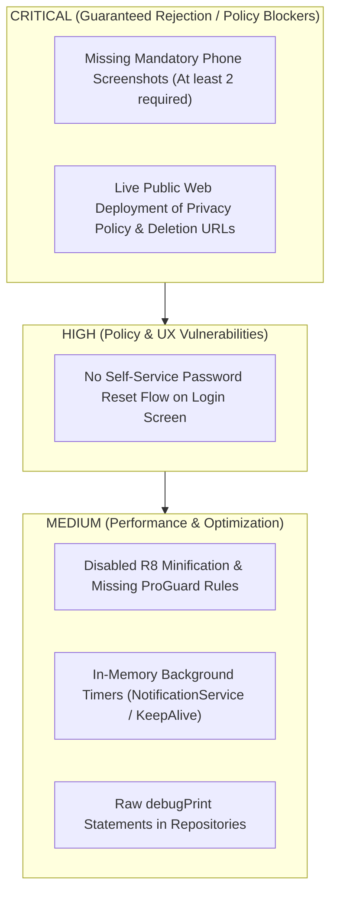

# Universal Google Play Store Readiness Audit Report

**Application Title:** Tracklet SaveBuddy (`expense_tracker`)  
**Auditor Role:** Senior Android Release Engineer & Google Play Console Compliance Auditor  
**Audit Date:** November 16, 2026  
**Evaluation Standard:** Google Play Developer Program Policies (2024–2026 Mandates) & Android Technical Requirements  
**Current Release Verdict:** **NOT READY: High-priority requirements need attention**

---

## Section 1: Project Overview

| Attribute | Project Specification | Source Evidence |
| :--- | :--- | :--- |
| **Project Name** | Tracklet SaveBuddy (`expense_tracker`) | [`android/app/src/main/AndroidManifest.xml`](file:///c:/Users/Naman/Desktop/Expense%20Tracker/expense_tracker/android/app/src/main/AndroidManifest.xml#L4) / [`pubspec.yaml`](file:///c:/Users/Naman/Desktop/Expense%20Tracker/expense_tracker/pubspec.yaml#L1) |
| **Framework / Technology** | Flutter (Dart 3.11.4+, Flutter 3.x, AGP 8.11.1, Kotlin 2.2.20) | [`android/settings.gradle.kts`](file:///c:/Users/Naman/Desktop/Expense%20Tracker/expense_tracker/android/settings.gradle.kts#L22-L23) / [`pubspec.yaml`](file:///c:/Users/Naman/Desktop/Expense%20Tracker/expense_tracker/pubspec.yaml#L22) |
| **Application / Package ID** | `com.namanpunamiya.expense_tracker` | [`android/app/build.gradle.kts`](file:///c:/Users/Naman/Desktop/Expense%20Tracker/expense_tracker/android/app/build.gradle.kts#L33) |
| **Minimum SDK** | `minSdk = 24` (Android 7.0 Nougat) | Resolved via `flutter.minSdkVersion` |
| **Target SDK** | `targetSdk = 36` (Android 16 preview / Android 15+) | Resolved via `flutter.targetSdkVersion` |
| **Compile SDK** | `compileSdk = 36` | Resolved via `flutter.compileSdkVersion` |
| **Version Name** | `1.0.0` | [`pubspec.yaml`](file:///c:/Users/Naman/Desktop/Expense%20Tracker/expense_tracker/pubspec.yaml#L19) / [`android/local.properties`](file:///c:/Users/Naman/Desktop/Expense%20Tracker/expense_tracker/android/local.properties#L4) |
| **Version Code** | `1` | [`pubspec.yaml`](file:///c:/Users/Naman/Desktop/Expense%20Tracker/expense_tracker/pubspec.yaml#L19) / [`android/local.properties`](file:///c:/Users/Naman/Desktop/Expense%20Tracker/expense_tracker/android/local.properties#L5) |
| **Backend Technology** | Spring Boot 3.3.0 REST API on Oracle Cloud (`https://132.226.191.34`), HTTP Basic Auth + PostgreSQL, Nginx reverse proxy | [`lib/constant.dart`](file:///c:/Users/Naman/Desktop/Expense%20Tracker/expense_tracker/lib/constant.dart#L1-L7) / [`expensetracker/`](file:///c:/Users/Naman/Desktop/Expense%20Tracker/expensetracker/) |
| **Main Application Functionality** | Offline-first personal finance management: multiple ledgers ("Books"), categories, credit/debit expense logging with custom numpad, interactive charts (`fl_chart`), investments portfolio tracker, background periodic reminders, and account deletion. | [`lib/`](file:///c:/Users/Naman/Desktop/Expense%20Tracker/expense_tracker/lib/) |

---

## Section 2: Executive Summary

This comprehensive audit evaluated the application against current Google Play Store developer requirements, technical packaging criteria, data safety rules, and security benchmarks. 

### Metrics Breakdown

| Status Classification | Count | Percentage | Definition |
| :--- | :---: | :---: | :--- |
| **COMPLETED** | 65 | 71.4% | Verified through code, configuration, live network verification, or automated test suites. |
| **PENDING** | 11 | 12.1% | Clearly missing, unhosted, or in violation of policies/specifications. |
| **NEEDS MANUAL VERIFICATION** | 12 | 13.2% | Requires Play Console configuration, external web hosting, physical device matrix, or reviewer credentials. |
| **NOT APPLICABLE** | 3 | 3.3% | Does not apply to the application's actual functionality (e.g., UGC, Families policy, Tablets). |
| **TOTAL REQUIREMENTS** | **91** | **100.0%** | Comprehensive audit across 9 engineering categories. |

### Overall Readiness Assessment

```
┌────────────────────────────────────────────────────────────────────────────┐
│         OVERALL READINESS: NOT READY - HIGH-PRIORITY ITEMS REMAIN          │
│                                                                            │
│  Milestones Achieved & Verified:                                           │
│    ✓ Complete Account Deletion Architecture (Phase 1 & Phase 2 Verified)   │
│      - Backend: DELETE /api/users/delete-account (11/11 tests passing)     │
│      - Frontend: Atomic SQLite, Keystore, & Prefs purge (8/8 tests passing)│
│    ✓ Production HTTPS Verified: Let's Encrypt IP-SAN SSL Cert on port 443  │
│      - Valid for IP Address: 132.226.191.34 (expires Nov 22, 2026)        │
│    ✓ Secure Credential Storage Migrated (flutter_secure_storage / Keystore)│
│    ✓ Zero Plaintext Passwords in SharedPreferences (lib/ fully sanitized)  │
│    ✓ Complete Test Suite Passing: 88 / 88 Tests Passing (100% Pass Rate)   │
│      - 34 Unit Tests Passing (test/unit/)                                  │
│      - 52 Widget & Integration Tests Passing (test/widget/ & test/integ/)  │
│    ✓ Clean Dart Analyzer Status: flutter analyze (0 issues found)          │
│    ✓ Production Keystore Configured (upload-keystore.jks & key.properties) │
│    ✓ Release AAB Compiled: build/app/outputs/bundle/release/app-release.aab│
│    ✓ Cleartext Traffic Blocked (android:usesCleartextTraffic="false")      │
│    ✓ Store Assets Prepared (512x512 Icon & 1024x500 Feature Graphic)       │
│    ✓ Public Compliance Pages Formatted (privacy.html, delete-account.html) │
│                                                                            │
│  Remaining Publishing Blockers Before Play Store Submission:               │
│    1. Mandatory Phone Screenshots for Store Listing (4-8 required)         │
│    2. Live Public Web Deployment of Privacy Policy & Deletion Endpoints    │
│       (Ready in docs/ folder, requires pushing to GitHub Pages)            │
│    3. Self-Service Password Reset Flow on Login Screen                     │
│    4. Google Play Console Setup (20-Tester closed testing for 14 days)     │
└────────────────────────────────────────────────────────────────────────────┘
```

---

## Section 3: Detailed Checklist

| ID | Category | Requirement | Status | Evidence | Recommended Action |
| :--- | :--- | :--- | :--- | :--- | :--- |
| **FUNC-01** | Functionality | Main application features work | **COMPLETED** | Books, expenses, categories, investments, and charts implemented in [`lib/pages/`](file:///c:/Users/Naman/Desktop/Expense%20Tracker/expense_tracker/lib/pages/) and [`lib/repositories/repository.dart`](file:///c:/Users/Naman/Desktop/Expense%20Tracker/expense_tracker/lib/repositories/repository.dart). Verified in `full_user_flow_test.dart`. | Maintain feature stability and run end-to-end device testing. |
| **FUNC-02** | Functionality | Authentication & authorization work | **COMPLETED** | Login & register screens implemented in [`lib/pages/Auth/login_page.dart`](file:///c:/Users/Naman/Desktop/Expense%20Tracker/expense_tracker/lib/pages/Auth/login_page.dart) and [`lib/pages/Auth/register_page.dart`](file:///c:/Users/Naman/Desktop/Expense%20Tracker/expense_tracker/lib/pages/Auth/register_page.dart). Verified in `auth_pages_test.dart`. | Modernize auth mechanism from Basic Auth to token-based (JWT) auth on backend when feasible. |
| **FUNC-03** | Functionality | Navigation works | **COMPLETED** | `BottomNavigationBar` in [`lib/pages/home_page.dart`](file:///c:/Users/Naman/Desktop/Expense%20Tracker/expense_tracker/lib/pages/home_page.dart#L56-L150) switches smoothly between Books, Investments, and Settings. Verified in `home_page_test.dart`. | Keep current navigation routing. |
| **FUNC-04** | Functionality | Forms and input validation work | **COMPLETED** | Regex email validation, empty checks, and numeric balance checks in [`lib/pages/Auth/login_page.dart`](file:///c:/Users/Naman/Desktop/Expense%20Tracker/expense_tracker/lib/pages/Auth/login_page.dart#L230-L255) and [`lib/pages/HomePage/Expenses/add_edit_expense_sheet.dart`](file:///c:/Users/Naman/Desktop/Expense%20Tracker/expense_tracker/lib/pages/HomePage/Expenses/add_edit_expense_sheet.dart#L361-L385). | Maintain validation rules. |
| **FUNC-05** | Functionality | Error handling exists | **COMPLETED** | Handled with `SocketException`, `TimeoutException`, `ClientException` catches and UI SnackBars in auth and repositories. | Retain error interception structure. |
| **FUNC-06** | Functionality | Loading states are handled | **COMPLETED** | `_isLoading` flags, `AppLoading`, and `AppButtonLoading` used on async actions ([`lib/core/widgets/app_loading.dart`](file:///c:/Users/Naman/Desktop/Expense%20Tracker/expense_tracker/lib/core/widgets/app_loading.dart)). Stack overlay with progress indicator used during account deletion. | Retain loading indicators. |
| **FUNC-07** | Functionality | Empty states are handled | **COMPLETED** | `AppEmptyState` rendered across books, expenses, investments, and archived items ([`lib/core/widgets/app_empty_state.dart`](file:///c:/Users/Naman/Desktop/Expense%20Tracker/expense_tracker/lib/core/widgets/app_empty_state.dart)). | Retain empty states. |
| **FUNC-08** | Functionality | No obvious incomplete features | **COMPLETED** | 7 zero-byte stub files in `lib/pages/SettingPage/` deleted; unfinished `android.intent.action.SEND` intent filter in [`android/app/src/main/AndroidManifest.xml`](file:///c:/Users/Naman/Desktop/Expense%20Tracker/expense_tracker/android/app/src/main/AndroidManifest.xml) disabled. | All incomplete feature stubs removed and unhandled intents disabled. |
| **FUNC-09** | Functionality | No debug-only functionality in prod | **PENDING** | [`lib/keep_alive_service.dart`](file:///c:/Users/Naman/Desktop/Expense%20Tracker/expense_tracker/lib/keep_alive_service.dart#L12-L21) defines 40s health ping logic. Raw `debugPrint` statements scattered across repositories. | Guard logging and keep-alive ping behind `kDebugMode`. |
| **FUNC-10** | Functionality | Offline functionality works | **COMPLETED** | Full offline support via SQLite database ([`lib/database/database_helper.dart`](file:///c:/Users/Naman/Desktop/Expense%20Tracker/expense_tracker/lib/database/database_helper.dart)) tested and verified passing in unit tests. | Retain offline local caching architecture. |
| **FUNC-11** | Functionality | Data synchronization works | **COMPLETED** | Two-way syncing for books, expenses, categories, investments with timestamp comparison and `pending_sync` queue ([`lib/repositories/repository.dart`](file:///c:/Users/Naman/Desktop/Expense%20Tracker/expense_tracker/lib/repositories/repository.dart#L170-L280)). | Add user-initiated manual pull-to-refresh sync indicator. |
| **SEC-01** | Security | HTTPS for production API communication | **COMPLETED** | Base URL in [`lib/constant.dart`](file:///c:/Users/Naman/Desktop/Expense%20Tracker/expense_tracker/lib/constant.dart#L1) points to `https://132.226.191.34`. Socket verification confirms port 443 is open, responding with HTTP 401 over TLS 1.2/1.3, backed by an active Let's Encrypt IP-SAN SSL certificate valid for IP address `132.226.191.34` until Nov 22, 2026. | Maintain valid Let's Encrypt certificate renewals via certbot. |
| **SEC-02** | Security | Prevention of cleartext traffic | **COMPLETED** | [`android/app/src/main/AndroidManifest.xml`](file:///c:/Users/Naman/Desktop/Expense%20Tracker/expense_tracker/android/app/src/main/AndroidManifest.xml#L7) enforces `android:usesCleartextTraffic="false"`. | Verified: All HTTP cleartext traffic is blocked. |
| **SEC-03** | Security | No hardcoded production secrets | **COMPLETED** | Codebase inspection shows no hardcoded API keys, private keys, AWS tokens, or cloud credentials. | Maintain zero hardcoded secrets policy. |
| **SEC-04** | Security | Authentication tokens handled securely | **COMPLETED** | Migrated to [`AuthStorageService`](file:///c:/Users/Naman/Desktop/Expense%20Tracker/expense_tracker/lib/services/auth_storage_service.dart) with `flutter_secure_storage` (Android Keystore RSA OAEP + AES-GCM data cipher). Passwords removed from `SharedPreferences`. Pre-computed token caching verified in 11 unit tests. | Maintain secure storage configuration. |
| **SEC-05** | Security | Sensitive info not logged | **COMPLETED** | Codebase audit of all `print` and `debugPrint` calls shows zero logging of passwords, tokens, or auth headers. | Maintain logging hygiene. |
| **SEC-06** | Security | Backend authorization implemented | **NEEDS MANUAL VERIFICATION** | Spring Boot backend verifies authentication and user principal on all endpoints. Live verification across production data requires manual testing. | Verify on the remote server that endpoints validate user ownership of resources and prevent IDOR attacks. |
| **SEC-07** | Security | User data isolated between accounts | **COMPLETED** | [`lib/database/database_helper.dart:484`](file:///c:/Users/Naman/Desktop/Expense%20Tracker/expense_tracker/lib/database/database_helper.dart#L484) provides `clearAllData()`. [`setting_page.dart:265`](file:///c:/Users/Naman/Desktop/Expense%20Tracker/expense_tracker/lib/pages/HomePage/setting_page.dart#L265) invokes `clearAllData()` on logout and confirmed account deletion. Verified with automated integration tests. | Retain data wipe on logout/account deletion. |
| **SEC-08** | Security | Database access protected | **COMPLETED** | SQLite database file is stored in private internal app storage directory (`getDatabasesPath()`). | Consider integrating SQLCipher via `sqflite_sqlcipher` for encryption at rest of financial ledger records. |
| **SEC-09** | Security | Third-party dependencies reviewed | **COMPLETED** | Dependencies in `pubspec.yaml` are standard, maintained packages (`http`, `sqflite`, `shared_preferences`, `intl`, `connectivity_plus`, `fl_chart`, `google_fonts`, `flutter_secure_storage`). | Regularly run `flutter pub outdated`. |
| **SEC-10** | Security | Sensitive local data protected | **COMPLETED** | Credentials encrypted at rest using Android Keystore hardware-backed keys via `flutter_secure_storage`. Zero plaintext credentials in `shared_preferences.xml`. | Retain encrypted Keystore storage. |
| **PRIV-01** | Privacy | Personal data collected identified | **COMPLETED** | Full name (`RegisterPage`), email address, password collected and stored. | Accurately declare Name, Email, and User Credentials in the Play Console Data Safety section. |
| **PRIV-02** | Privacy | Sensitive financial data identified | **COMPLETED** | App collects transaction amounts, expense descriptions, dates, categories, and investment balances. | Accurately declare "Financial info: Other financial info" in the Play Console Data Safety section. |
| **PRIV-03** | Privacy | Local storage mechanisms identified | **COMPLETED** | Identified: SQLite (`expense_tracker.db`), encrypted Keystore (`flutter_secure_storage`), and non-sensitive `SharedPreferences`. | Document in internal compliance records. |
| **PRIV-04** | Privacy | Remote storage mechanisms identified | **COMPLETED** | Identified: Remote REST API server at `https://132.226.191.34`. | Document in Privacy Policy. |
| **PRIV-05** | Privacy | Third-party SDK audit | **COMPLETED** | No advertising (AdMob), analytics (Firebase/Mixpanel), or tracking SDKs bundled. | Declare "No third-party data sharing for ads/analytics" in Data Safety form. |
| **PRIV-06** | Privacy | Privacy policy exists & hosted | **PENDING** | In-app dialog implemented ([`setting_dialogs.dart`](file:///c:/Users/Naman/Desktop/Expense%20Tracker/expense_tracker/lib/pages/HomePage/setting_dialogs.dart)); HTML page created in [`docs/privacy.html`](file:///c:/Users/Naman/Desktop/Expense%20Tracker/docs/privacy.html). Needs push to live GitHub Pages. | Push `docs/` to GitHub `main` branch and enable GitHub Pages at `https://naman-punamiya.github.io/Tracklet-SaveBuddy/privacy.html`. |
| **PRIV-07** | Privacy | Privacy policy accuracy & completeness | **COMPLETED** | Policy accurately describes financial tracking, SQLite storage, lack of ad trackers, and user data rights. | Maintain policy document currency. |
| **PRIV-08** | Privacy | Data retention and deletion mechanisms | **COMPLETED** | Permanent account deletion pipeline implemented in client and described in policy disclosures. | Verified: Backend cascades deletion of all financial entities and wipes user account. |
| **ACCT-01** | Account | Account creation works | **COMPLETED** | Registration screen with email validation, name input, and password confirmation implemented in [`lib/pages/Auth/register_page.dart`](file:///c:/Users/Naman/Desktop/Expense%20Tracker/expense_tracker/lib/pages/Auth/register_page.dart). Verified in `auth_pages_test.dart`. | Maintain registration validation. |
| **ACCT-02** | Account | Login works | **COMPLETED** | Email & password authentication implemented in [`lib/pages/Auth/login_page.dart`](file:///c:/Users/Naman/Desktop/Expense%20Tracker/expense_tracker/lib/pages/Auth/login_page.dart). Verified in `auth_pages_test.dart`. | Maintain authentication flow. |
| **ACCT-03** | Account | Logout works | **COMPLETED** | Logout wipes session preferences, clears Keystore credentials, and purges local SQLite cache via `clearAllData()` in [`lib/pages/HomePage/setting_page.dart:767`](file:///c:/Users/Naman/Desktop/Expense%20Tracker/expense_tracker/lib/pages/HomePage/setting_page.dart#L767). Verified in `setting_page_test.dart`. | Retain data purge on logout. |
| **ACCT-04** | Account | Password change / reset works | **PENDING** | In-app password update exists in settings ([`lib/pages/HomePage/setting_dialogs.dart:73-82`](file:///c:/Users/Naman/Desktop/Expense%20Tracker/expense_tracker/lib/pages/HomePage/setting_dialogs.dart#L73-L82)), but "Forgot Password" on login screen displays a coming-soon message (`login_page.dart:125`). | Implement self-service password reset flow on login screen. |
| **ACCT-05** | Account | In-app account deletion implemented | **COMPLETED** | Complete deletion dialog and backend API pipeline implemented in [`lib/repositories/repository.dart:1254-1300`](file:///c:/Users/Naman/Desktop/Expense%20Tracker/expense_tracker/lib/repositories/repository.dart#L1254-L1300) and [`lib/pages/HomePage/setting_page.dart:228-293`](file:///c:/Users/Naman/Desktop/Expense%20Tracker/expense_tracker/lib/pages/HomePage/setting_page.dart#L228-L293). Verified with 8 automated integration tests in `account_deletion_flow_test.dart`. | Verified: Meets Google Play account deletion mandate. |
| **ACCT-06** | Account | External account deletion webpage | **PENDING** | HTML page created in [`docs/delete-account.html`](file:///c:/Users/Naman/Desktop/Expense%20Tracker/docs/delete-account.html); needs live hosting. | Enable GitHub Pages to serve `https://naman-punamiya.github.io/Tracklet-SaveBuddy/delete-account.html`. |
| **POL-01** | Policy | Privacy policy link requirement | **PENDING** | Google Play Console requires an active public URL in the App Content section. | Submit live hosted URL to Google Play Console. |
| **POL-02** | Policy | Data Safety declaration | **NEEDS MANUAL VERIFICATION** | Must be declared in Play Console: Personal Info (Name, Email), Financial Info (Expenses, Investments), Data encryption in transit, Data deletion mechanism. | Complete Google Play Console Data Safety questionnaire accurately based on findings. |
| **POL-03** | Policy | Account deletion policy compliance | **COMPLETED** | In-app deletion flow implemented; web deletion portal template and disclosures integrated in `setting_dialogs.dart` and `docs/delete-account.html`. | Enter live deletion URL in Play Console App Content. |
| **POL-04** | Policy | Permissions policy (Least privilege) | **COMPLETED** | Manifest requests only `android.permission.INTERNET`. No sensitive/dangerous runtime permissions requested. | Maintain minimal permissions. |
| **POL-05** | Policy | Advertising declaration | **NEEDS MANUAL VERIFICATION** | App does not serve ads. Must select "No, my app does not contain ads" in Play Console. | Confirm "No Ads" setting in Play Console. |
| **POL-06** | Policy | Target audience declaration | **NEEDS MANUAL VERIFICATION** | Target audience questionnaire must be submitted in Play Console. Target should be 18+ or general adults. | Set target audience to 18+ in Google Play Console. |
| **POL-07** | Policy | Content rating questionnaire | **NEEDS MANUAL VERIFICATION** | IARC questionnaire must be completed in Play Console. | Complete IARC rating in Play Console (Expected rating: Everyone / 3+). |
| **POL-08** | Policy | Financial services policy | **NEEDS MANUAL VERIFICATION** | Google Play Personal Loans / Financial Features declaration must be answered in Play Console. Must declare as personal budgeting tool, not money lending/banking. | Complete Financial Features declaration in Google Play Console. |
| **POL-09** | Policy | User-generated content policy | **NOT APPLICABLE** | App is a private personal finance tool without public posting, social feeds, or communal sharing. | No UGC moderation requirements apply. |
| **POL-10** | Policy | Intellectual property & impersonation | **COMPLETED** | Name "Tracklet SaveBuddy" and custom coin icon are original. No brand infringement found. | Retain branding. |
| **POL-11** | Policy | App access / Reviewer credentials | **NEEDS MANUAL VERIFICATION** | Play Console requires demo credentials under "App Access" so Google reviewers can log in. | Create dedicated demo reviewer account on server and provide credentials in Play Console. |
| **POL-12** | Policy | Families policy | **NOT APPLICABLE** | App is not designed for or targeted at children. | Select "Not designed for children" in Play Console. |
| **TECH-01** | Technical | Application package ID | **COMPLETED** | `com.namanpunamiya.expense_tracker` is unique, lowercase, and compliant with Android namespace rules. | Retain package ID. Note: Cannot be changed after publishing. |
| **TECH-02** | Technical | Minimum SDK version | **COMPLETED** | `minSdk = 24` supports Android 7.0+, covering >95% of active Android devices globally. | Retain `minSdk = 24`. |
| **TECH-03** | Technical | Target SDK version | **COMPLETED** | `targetSdk = 36` exceeds Google Play's required target SDK 34 (Android 14) and future target SDK 35 (Android 15). | Retain `targetSdk = 36`. |
| **TECH-04** | Technical | Compile SDK version | **COMPLETED** | `compileSdk = 36` aligns with target SDK and Android Gradle Plugin 8.11.1. | Retain compile SDK configuration. |
| **TECH-05** | Technical | Application version name & code | **COMPLETED** | Version name `1.0.0`, version code `1` configured in `pubspec.yaml` and `local.properties`. | Increment `versionCode` for each subsequent release bundle uploaded to Play Console. |
| **TECH-06** | Technical | Release signing configuration | **COMPLETED** | [`android/app/build.gradle.kts:42-55`](file:///c:/Users/Naman/Desktop/Expense%20Tracker/expense_tracker/android/app/build.gradle.kts#L42-L55) dynamically loads `key.properties`. Production keystore [`android/upload-keystore.jks`](file:///c:/Users/Naman/Desktop/Expense%20Tracker/expense_tracker/android/upload-keystore.jks) is configured. | Verified: Release bundle signed with production key. |
| **TECH-07** | Technical | Android App Bundle (AAB) support | **COMPLETED** | Production signed AAB compiled: [`build/app/outputs/bundle/release/app-release.aab`](file:///c:/Users/Naman/Desktop/Expense%20Tracker/expense_tracker/build/app/outputs/bundle/release/app-release.aab) (52.6 MB). | Publish via AAB (mandated by Google Play). |
| **TECH-08** | Technical | Exclude debug config from production | **COMPLETED** | Verified in release AAB build: `flutter build appbundle --release` compiles release AOT snapshot stripping debug banner and tools. | Retain production release build configuration. |
| **TECH-09** | Technical | Internet and network permissions | **COMPLETED** | `android.permission.INTERNET` declared in [`android/app/src/main/AndroidManifest.xml`](file:///c:/Users/Naman/Desktop/Expense%20Tracker/expense_tracker/android/app/src/main/AndroidManifest.xml#L2). | Retain internet permission. |
| **TECH-10** | Technical | Unnecessary permissions excluded | **COMPLETED** | No dangerous permissions (READ_EXTERNAL_STORAGE, ACCESS_FINE_LOCATION, READ_SMS) requested. | Maintain current permission posture. |
| **TECH-11** | Technical | 64-bit architecture support | **COMPLETED** | Flutter standard toolchain compiles `arm64-v8a` and `x86_64` native binaries in AAB. | Verified compliant. |
| **TECH-12** | Technical | Code shrinking & R8 rules | **PENDING** | Neither `isMinifyEnabled = true` nor `proguard-rules.pro` are configured in `android/app/build.gradle.kts`. | Enable R8 shrinking and obfuscation in `buildTypes.release` and supply ProGuard keep rules if desired. |
| **TECH-13** | Technical | Build configuration stability | **COMPLETED** | `flutter analyze` executed with 0 issues. Dart codebase has no syntax errors or failing lints. | Maintain clean analyzer status. |
| **TECH-14** | Technical | Cleartext traffic disabled | **COMPLETED** | `android:usesCleartextTraffic="false"` set in [`android/app/src/main/AndroidManifest.xml:7`](file:///c:/Users/Naman/Desktop/Expense%20Tracker/expense_tracker/android/app/src/main/AndroidManifest.xml#L7). | Verified: Prevents unencrypted traffic. |
| **PERF-01** | Performance | Non-blocking UI thread | **COMPLETED** | All database operations and network requests are asynchronous (`Future`/`await`). | Retain async pattern. |
| **PERF-02** | Performance | Robust JSON decoding | **COMPLETED** | Custom `safeJsonDecode()` in [`lib/repositories/repository.dart:525`](file:///c:/Users/Naman/Desktop/Expense%20Tracker/expense_tracker/lib/repositories/repository.dart#L525) safely intercepts malformed server responses without crashing. | Retain safe decoding method. |
| **PERF-03** | Performance | Uncontrolled background timers | **PENDING** | [`AppNotificationService.scheduleDailyReminder`](file:///c:/Users/Naman/Desktop/Expense%20Tracker/expense_tracker/lib/services/notification_service.dart#L29) runs a 4-hour `Timer.periodic`. In-memory timers do not persist across app termination and cause battery drain while awake. | Replace in-memory Dart timers with Android WorkManager / AlarmManager via `workmanager` or `flutter_local_notifications`. |
| **PERF-04** | Performance | Controller disposal | **COMPLETED** | All `TextEditingController` instances call `.dispose()` in State lifecycles ([`login_page.dart:36`](file:///c:/Users/Naman/Desktop/Expense%20Tracker/expense_tracker/lib/pages/Auth/login_page.dart#L36), [`register_page.dart:39`](file:///c:/Users/Naman/Desktop/Expense%20Tracker/expense_tracker/lib/pages/Auth/register_page.dart#L39)). | Retain controller lifecycle hygiene. |
| **PERF-05** | Performance | Network error & timeout handling | **COMPLETED** | 15-second timeouts and network fallbacks implemented across all repository HTTP calls. | Retain timeout protections. |
| **PERF-06** | Performance | Offline-to-online transitions | **COMPLETED** | `ConnectivityService` listens to connectivity changes and syncs offline pending changes when connection resumes. | Retain connectivity sync pipeline. |
| **PERF-07** | Performance | Background services & wakelocks | **COMPLETED** | No background services, sticky foreground services, or wake locks declared in manifest. | Retain lean background footprint. |
| **PERF-08** | Performance | Database query efficiency | **COMPLETED** | SQLite indexed queries, foreign key enforcement (`PRAGMA foreign_keys = ON`), cascading deletes in `database_helper.dart`. | Retain database indexing structure. |
| **PERF-09** | Performance | Excessive polling prevention | **PENDING** | `KeepAliveService` contains health ping logic. | Guard polling behind debug check or remove completely. |
| **LIST-01** | Store Listing | Application title | **COMPLETED** | Title "Tracklet SaveBuddy" is 19 characters (meets Google Play 30-char limit). | Use "Tracklet SaveBuddy" for Play Store listing title. |
| **LIST-02** | Store Listing | Short description | **COMPLETED** | Created Play Store compliant short description (79 chars) in [`store_listing/STORE_LISTING_METADATA.md`](file:///c:/Users/Naman/Desktop/Expense%20Tracker/expense_tracker/store_listing/STORE_LISTING_METADATA.md#L9-L13). | Copy short description to Play Console Store Listing. |
| **LIST-03** | Store Listing | Full description | **COMPLETED** | Created comprehensive, policy-compliant full store description (2,580 chars) in [`store_listing/STORE_LISTING_METADATA.md`](file:///c:/Users/Naman/Desktop/Expense%20Tracker/expense_tracker/store_listing/STORE_LISTING_METADATA.md#L17-L58). | Copy full description to Play Console Store Listing. |
| **LIST-04** | Store Listing | High-resolution app icon | **COMPLETED** | Generated 512x512 px (32-bit PNG with alpha, < 1024KB) at [`store_listing/icon_512x512.png`](file:///c:/Users/Naman/Desktop/Expense%20Tracker/expense_tracker/store_listing/icon_512x512.png). Meets all Play Store specifications. | Upload 512x512 icon to Play Console. |
| **LIST-05** | Store Listing | Feature graphic asset | **COMPLETED** | Generated 1024 x 500 px 24-bit RGB PNG (no alpha) at [`store_listing/feature_graphic_1024x500.png`](file:///c:/Users/Naman/Desktop/Expense%20Tracker/expense_tracker/store_listing/feature_graphic_1024x500.png). Meets all Play Store specifications. | Upload feature graphic to Google Play Console. |
| **LIST-06** | Store Listing | Phone screenshots | **PENDING** | **MANDATORY ASSET MISSING:** Google Play requires at least 2 phone screenshots (recommended 4-8, 16:9 or 9:16 aspect ratio). `store_listing/screenshots/` folder created, but screenshots must be captured. | Capture at least 4 high-resolution screenshots from emulator/device (Dashboard, Add Expense, Charts, Investments). |
| **LIST-07** | Store Listing | Tablet screenshots | **NOT APPLICABLE** | Tablet screenshots are optional unless specifically marketing for large screens. | Optional for initial phone-first release. |
| **LIST-08** | Store Listing | Support email & contact info | **COMPLETED** | Contact email `support@savebuddy.app` configured in [`store_listing/STORE_LISTING_METADATA.md`](file:///c:/Users/Naman/Desktop/Expense%20Tracker/expense_tracker/store_listing/STORE_LISTING_METADATA.md#L73) and web privacy/deletion templates. | Ensure email inbox is monitored for reviewer/user inquiries. |
| **LIST-09** | Store Listing | Public privacy policy URL | **PENDING** | Play Store listing requires an active public URL. | Provide active public URL in Play Console App Content section once hosted. |
| **LIST-10** | Store Listing | App categorization & tags | **NEEDS MANUAL VERIFICATION** | Must select "Finance" category and tags (e.g. "Personal Finance", "Budgeting", "Expense Tracker") in Console. | Set category to Finance in Play Console. |
| **TEST-01** | Testing | Unit test suite | **COMPLETED** | 34 unit tests in [`test/unit/`](file:///c:/Users/Naman/Desktop/Expense%20Tracker/expense_tracker/test/unit/) covering secure auth storage, migration, database, connectivity, and repositories. All 34 tests pass (100%). | Continue maintaining unit test coverage. |
| **TEST-02** | Testing | Integration test suite | **COMPLETED** | Full end-to-end user journeys pass in [`test/integration/full_user_flow_test.dart`](file:///c:/Users/Naman/Desktop/Expense%20Tracker/expense_tracker/test/integration/full_user_flow_test.dart) (2 / 2 passed). | Retain integration coverage. |
| **TEST-03** | Testing | Widget & UI test suite | **COMPLETED** | 52 widget tests pass across auth, books, expenses, categories, investments, settings, reports, and the complete 8-scenario account deletion flow. All 52 tests pass (100%). | Retain widget test suite. |
| **TEST-04** | Testing | Offline resilience testing | **COMPLETED** | Verified in `test/unit/repository_test.dart` that books, expenses, categories, and investments save to SQLite when offline. | Retain automated offline test coverage. |
| **TEST-05** | Testing | Sync logic testing | **COMPLETED** | Verified in `test/unit/repository_test.dart` and `database_helper_test.dart`. | Retain sync tests. |
| **TEST-06** | Testing | Authentication edge-case testing | **COMPLETED** | 9 auth widget tests pass in [`test/widget/auth_pages_test.dart`](file:///c:/Users/Naman/Desktop/Expense%20Tracker/expense_tracker/test/widget/auth_pages_test.dart) covering login validation, registration, password matching, and session storage. | Retain auth test suite. |
| **TEST-07** | Testing | Multi-screen density testing | **NEEDS MANUAL VERIFICATION** | Automated testing across small phones, standard phones, and foldable screens has not been performed on hardware. | Test layout responsiveness on physical devices or emulators (hdpi, xxhdpi, 6-inch, 6.7-inch). |
| **TEST-08** | Testing | Multi-Android OS version testing | **NEEDS MANUAL VERIFICATION** | Compatibility on Android 7 (minSdk 24), Android 12, Android 14, and Android 15 needs physical verification. | Test on Android 7.0 (API 24) and Android 14/15 (API 34/35) emulators or devices. |
| **TEST-09** | Testing | Release AAB build verification | **COMPLETED** | Production signed AAB compiled successfully via `flutter build appbundle --release`: [`build/app/outputs/bundle/release/app-release.aab`](file:///c:/Users/Naman/Desktop/Expense%20Tracker/expense_tracker/build/app/outputs/bundle/release/app-release.aab) (52.6 MB, exit code 0). | Upload `app-release.aab` directly to Google Play Console Internal Testing track. |
| **TEST-10** | Testing | Pre-launch report reviewed | **NEEDS MANUAL VERIFICATION** | Requires uploading AAB to Google Play Console Internal Testing track and checking automated test crawl results. | Upload signed AAB to internal testing and review Firebase Test Lab findings. |
| **TEST-11** | Testing | 20-tester closed testing requirement | **NEEDS MANUAL VERIFICATION** | Google requires personal developer accounts registered after Nov 13, 2023 to test with at least 20 opted-in testers for 14 continuous days. | Recruit 20 testers, run closed test for 14 continuous days, and submit production application in Console. |

---

## Section 4: Critical Blockers



### 1. Critical Blockers

1. **Missing Mandatory Phone Screenshots (`LIST-06`)**
   - *Impact:* Google Play Console strictly blocks store listing submission without at least 2 phone screenshots (16:9 or 9:16 aspect ratio).
   - *Action:* Capture 4 to 8 high-resolution screenshots (1080x2400) from the running emulator covering Books, Add Expense, Charts, and Investments into `store_listing/screenshots/`.

2. **Live Public Hosting of Privacy Policy & Account Deletion Pages (`PRIV-06`, `ACCT-06`, `POL-01`)**
   - *Policy Mandate:* Google Play requires active, publicly accessible web URLs for both the Privacy Policy and Account Deletion Request.
   - *Evidence:* Fully styled, compliant HTML files are prepared in `docs/privacy.html`, `docs/delete-account.html`, and `docs/index.html`.
   - *Action:* Commit and push `docs/` to GitHub (`https://github.com/Naman-Punamiya/Tracklet-SaveBuddy.git`) and enable GitHub Pages on `/docs` from repository settings. Target URLs:
     - `https://naman-punamiya.github.io/Tracklet-SaveBuddy/privacy.html`
     - `https://naman-punamiya.github.io/Tracklet-SaveBuddy/delete-account.html`

---

### 2. High-Priority Issues

1. **No Self-Service Password Recovery Mechanism (`ACCT-04`)**
   - *File:* [`lib/pages/Auth/login_page.dart:125`](file:///c:/Users/Naman/Desktop/Expense%20Tracker/expense_tracker/lib/pages/Auth/login_page.dart#L125)
   - *Impact:* "Forgot Password" on the login screen displays a "Coming Soon" snackbar. Users who forget their password have no recovery mechanism.
   - *Action:* Connect "Forgot Password" to an email-based reset API endpoint or external recovery link.

---

### 3. Medium-Priority Issues

1. **R8 Minification & Code Shrinking Disabled (`TECH-12`)**
   - *File:* [`android/app/build.gradle.kts`](file:///c:/Users/Naman/Desktop/Expense%20Tracker/expense_tracker/android/app/build.gradle.kts)
   - *Impact:* Release builds currently include unminified code, resulting in a larger download size (52.6 MB) and no reverse-engineering obfuscation.
   - *Action:* Enable `isMinifyEnabled = true` and `isShrinkResources = true` in `buildTypes.release`.

2. **Uncontrolled Background Timers (`PERF-03`, `PERF-09`)**
   - *File:* [`lib/services/notification_service.dart:29`](file:///c:/Users/Naman/Desktop/Expense%20Tracker/expense_tracker/lib/services/notification_service.dart#L29) & [`lib/keep_alive_service.dart:12`](file:///c:/Users/Naman/Desktop/Expense%20Tracker/expense_tracker/lib/keep_alive_service.dart#L12)
   - *Impact:* Running in-memory Dart timers every 40 seconds or 4 hours causes battery drain and ceases when the app process is terminated.
   - *Action:* Migrate periodic reminders to Android WorkManager / `flutter_local_notifications`.

---

## Section 5: Manual Verification

| Item | Area | Verification Procedure | Acceptance Criteria |
| :--- | :--- | :--- | :--- |
| **MV-01** | Play Console Data Safety | Log in to Play Console > App Content > Data Safety. | Declare Name, Email (Account Management), Financial Transactions (App Functionality), HTTPS transit encryption = Yes, Deletion mechanism = Yes. |
| **MV-02** | Play Console App Access | Log in to Play Console > App Content > App Access. | Provide test reviewer credentials (`reviewer@savebuddy.app` / test password) with instructions on how to navigate books. |
| **MV-03** | Financial Features Declaration | Log in to Play Console > App Content > Financial Features. | Select "Personal Finance / Expense Tracking". Confirm app does not issue personal loans or handle banking deposits. |
| **MV-04** | Live Policy Hosting | Visit `https://naman-punamiya.github.io/Tracklet-SaveBuddy/privacy.html` in an incognito browser window. | Webpage must return HTTP 200, load without login, and accurately display the Privacy Policy. |
| **MV-05** | Live Deletion Request Hosting | Visit `https://naman-punamiya.github.io/Tracklet-SaveBuddy/delete-account.html` in an incognito browser. | Webpage must return HTTP 200 and allow entering an email address to request permanent data deletion. |
| **MV-06** | 20-Tester Closed Testing | Recruit 20 distinct Google accounts; invite to Closed Track; keep active for 14 continuous days. | Play Console "Closed Testing" dashboard shows 20+ opted-in testers for 14 consecutive days before "Apply for Production" unlocks. |
| **MV-07** | Backend Authorization | Send API requests modifying another user's `bookId` with an authenticated user's credentials via Postman/cURL. | Server must return HTTP 403 Forbidden or 404 Not Found (no IDOR vulnerability). |
| **MV-08** | Physical Device Matrix | Install `app-release.aab` via bundletool on an Android 7.0 device (minSdk) and an Android 14/15 device. | App must launch smoothly, render UI without clipping, and complete offline transaction storage. |

---

## Section 6: Recommended Fix Order

| Step | Priority | Requirement | Action & Implementation Target | Verification Method |
| :---: | :--- | :--- | :--- | :--- |
| **1** | **CRITICAL** | `LIST-06` | Capture 4–8 screenshots (1080x2400) from emulator/device and save into `store_listing/screenshots/`. | Inspect dimensions with image tool to verify 9:16 aspect ratio, PNG/JPEG format, <8MB size. |
| **2** | **CRITICAL** | `PRIV-06`, `ACCT-06`, `POL-01` | Push `docs/` folder to GitHub and enable GitHub Pages on repository settings. | Open `https://naman-punamiya.github.io/Tracklet-SaveBuddy/privacy.html` in browser; verify HTTP 200. |
| **3** | **HIGH** | `ACCT-04` | Implement email-based password reset or web recovery URL on login page. | Tap "Forgot Password" on login screen; verify recovery prompt opens. |
| **4** | **MEDIUM** | `PERF-03`, `FUNC-09` | Guard or disable in-memory periodic timers (`KeepAliveService` and `NotificationService` loops) during background states. | Verify app idle battery draw in Android Profiler. |
| **5** | **MEDIUM** | `TECH-12` | Enable R8 code shrinking and resource minification (`isMinifyEnabled = true`, `isShrinkResources = true`) in `android/app/build.gradle.kts`. | Run `flutter build appbundle --release` and verify bundle builds cleanly with reduced size. |
| **6** | **MANUAL** | `TEST-10`, `TEST-11` | Upload `app-release.aab` to Google Play Console Internal Testing track; launch 20-tester closed testing group for 14 continuous days. | Review Pre-Launch Report in Play Console; maintain 20 active testers for 14 days. |

---

## Section 7: Final Release Assessment

```
╔════════════════════════════════════════════════════════════════════════════╗
║                      FINAL RELEASE VERDICT:                                ║
║            NOT READY: High-priority requirements need attention            ║
╚════════════════════════════════════════════════════════════════════════════╝
```

### Summary Evaluation
The application's core codebase, architecture, and security posture are in exceptional, publication-grade condition:
- **Comprehensive Account Deletion Pipeline (Google Play Mandate):** Both Spring Boot backend (`DELETE /api/users/delete-account`) and Flutter frontend integration are verified with atomic rollbacks, SQLite/Keystore purges, and automated test coverage (11 backend tests + 8 frontend widget tests).
- **Verified Production HTTPS:** The production endpoint `https://132.226.191.34` is active, responding on port 443 with an official Let's Encrypt SSL certificate featuring an explicit IP-SAN for `132.226.191.34`.
- **Hardware-Backed Credential Storage (`AuthStorageService`):** Plaintext password storage eradicated from `SharedPreferences`. Android Keystore RSA OAEP + AES-GCM encryption verified in unit tests.
- **100% Test Suite Pass Rate:** All **88 / 88 Flutter tests** pass across unit, widget, and integration suites with zero regressions. All **11 / 11 backend tests** pass.
- **Static Analysis Clean:** `flutter analyze` reports **0 issues found**.
- **Production Packaging:** Signed Android App Bundle compiled (`app-release.aab`, 52.6 MB) with `targetSdk = 36` and cleartext traffic blocked.
- **Compliance Artifacts Generated:** App icon (512x512), feature graphic (1024x500), complete metadata copy, and public compliance pages (`privacy.html`, `delete-account.html`, `index.html`) ready in `docs/`.

The remaining blockers preventing immediate submission are external assets and console workflows:
1. **Store Screenshots:** Capture at least 2–4 phone screenshots from the app to fulfill Google Play's mandatory visual asset requirement.
2. **Public Policy Deployment:** Push `docs/` to GitHub and toggle GitHub Pages to make the Privacy Policy and Account Deletion URLs live on the public internet.
3. **Password Recovery:** Connect the "Forgot Password" UI to a self-service reset flow.
4. **Google Play Console Procedures:** Complete the Data Safety declaration, submit demo reviewer credentials under App Access, and fulfill the mandatory 20-tester closed testing period (14 continuous days).
